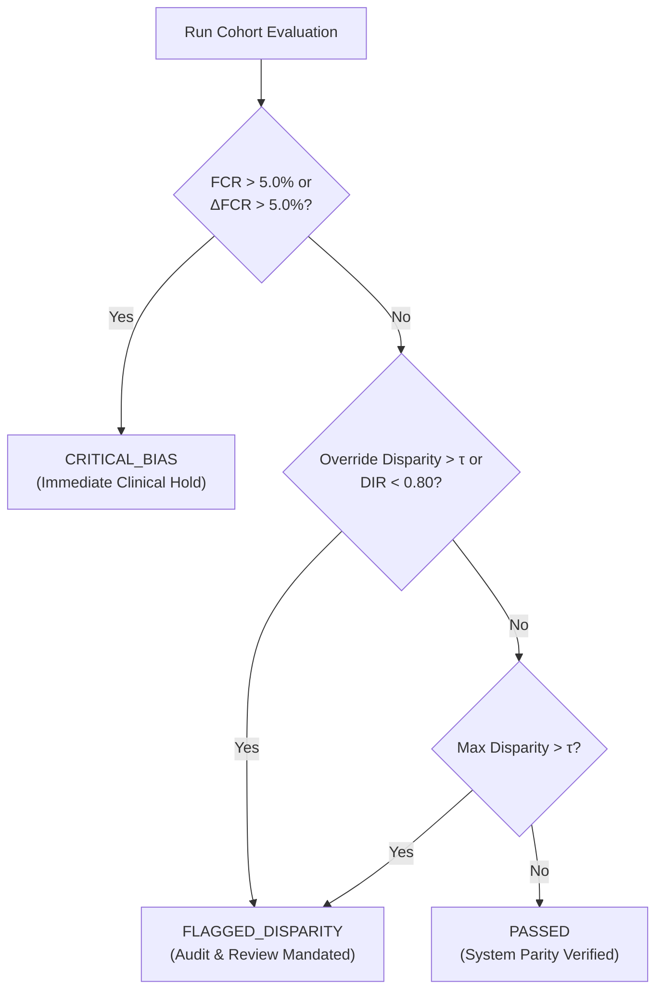

# SurgiGate Bias Evaluation Protocol: Health Equity & Algorithmic Parity Specification

> **Standard Operating Procedure & Formal Evaluation Protocol**  
> **Document Version:** 1.0.0  
> **Classification:** Engineering & Clinical Decision Support Specification  
> **System:** SurgiGate Evidence-Gated Pre-Operative Checklist & Surgical Safety Management System  
> **Target Cohorts:** Cohort Alpha (`grp-A`, Urban/Tertiary Center) & Cohort Beta (`grp-B`, Regional/Community Center)

---

## 1. Regulatory Context & Clinical Rationale

In high-acuity perioperative environments, checklist compliance metrics that appear uniformly high on aggregate can mask profound systemic health disparities between patient cohorts. When pre-operative safety protocols rely on unstructured checklists or administrative overrides, patients in resource-constrained or marginalized settings often experience:
1. **Elevated Override Rates**: Clinicians resorting to emergency bypass overrides because diagnostic lab or cardiology consultations face delayed turnaround times.
2. **False Completion**: Checklists marked as complete when underlying diagnostic evidence was delayed, expired, or absent.
3. **Disparate Time-to-OR**: Disproportionate surgical cancellations or delayed incision readiness resulting from uncoordinated specialist attestations.

This protocol formalizes an algorithmic auditing procedure to continuously measure, evaluate, and prevent demographic and structural bias across pre-operative checklists, complying with FDA Good Machine Learning Practice (GMLP) and health equity guidelines.

---

## 2. Selected Population Cohorts

The protocol continuously evaluates parity across two pre-configured patient population groups:

| Parameter | Cohort Alpha (`grp-A`: Reference Group) | Cohort Beta (`grp-B`: Comparison / Protected Group) |
| :--- | :--- | :--- |
| **Setting** | Metropolitan Tertiary Referral Hospital | Regional Community & District Health Center |
| **EMR Infrastructure** | Fully integrated digital HIS/PACS with automated lab feeds | Mixed digital-paper interface with external laboratory couriers |
| **Demographic Makeup** | Urban demographic baseline; private & commercial insurance | Regional, rural-referral, and public-assistance demographics |
| **Specialist Access** | 24/7 on-site subspecialists (Cardiology, Anesthesia, Pathology) | On-call or tele-consultant subspecialist panels |
| **Primary Evaluation Goal** | Establish high-watermark safety and attestation baseline | Ensure equivalent rigor, evidence verification, and low override rates |

---

## 3. Formal Metric Specifications & Mathematical Formulations

### 3.1. False-Completion Rate (FCR)
The **False-Completion Rate** quantifies the proportion of checklist safety milestones certified as `VERIFIED` or `OVERRIDE` when the required clinical evidence was either missing, expired, or unverifiable.

#### Mathematical Definition:
For a cohort $G \in \{A, B\}$, let $\mathcal{I}_G$ denote the set of checklist items assigned to patients in cohort $G$, and let $\mathcal{I}_G^{\text{req}} = \{i \in \mathcal{I}_G \mid \text{requires\_evidence}(i) = \text{True}\}$.

$$\text{FCR}(G) = \frac{\sum_{i \in \mathcal{I}_G^{\text{req}}} \mathbf{1}\Big(\text{status}(i) \in \{\text{'VERIFIED'}, \text{'OVERRIDE'}\} \land \text{evidence\_valid}(i) = \text{False}\Big)}{\big|\mathcal{I}_G^{\text{req}}\big|} \times 100\%$$

#### Disparity Formulation:
$$\Delta_{\text{FCR}} = \big|\text{FCR}(A) - \text{FCR}(B)\big|$$

- **Safety Target:** $\text{FCR}(A) \le 1.0\% \quad \text{and} \quad \text{FCR}(B) \le 1.0\%$
- **Disparity Threshold:** $\Delta_{\text{FCR}} \le 5.0\%$

---

### 3.2. Override Disparity (OD)
The **Override Rate** measures the frequency with which clinicians bypass safety criteria via administrative exception overrides. A substantial disparity between cohorts indicates potential structural pressure to proceed with surgery without proper pre-operative clearances.

#### Mathematical Definition:
$$\text{OverrideRate}(G) = \frac{\sum_{i \in \mathcal{I}_G} \mathbf{1}\big(\text{status}(i) = \text{'OVERRIDE'}\big)}{\big|\mathcal{I}_G\big|} \times 100\%$$

#### Absolute Override Disparity:
$$\text{OD} = \big|\text{OverrideRate}(A) - \text{OverrideRate}(B)\big|$$

#### Relative Override Ratio (ROR):
$$\text{ROR} = \frac{\text{OverrideRate}(B)}{\text{OverrideRate}(A)}$$

- **Parity Target:** $\text{OD} \le 10.0\%$ (Configurable system fairness threshold $\tau$)
- **Ratio Boundary:** $0.80 \le \text{ROR} \le 1.25$

---

### 3.3. Disparate Impact Ratio (DIR) / Four-Fifths Rule
Adapted from the EEOC 80% rule, the **Disparate Impact Ratio** assesses whether the rate of authenticated evidence verification in Cohort B is substantially inferior to that in Cohort A.

#### Mathematical Definition:
Let $\text{EVR}(G)$ be the Evidence Verification Rate for cohort $G$:
$$\text{EVR}(G) = \frac{\sum_{i \in \mathcal{I}_G^{\text{req}}} \mathbf{1}\big(\text{status}(i) = \text{'VERIFIED'} \land \text{evidence\_valid}(i) = \text{True}\big)}{\big|\mathcal{I}_G^{\text{req}}\big|}$$

$$\text{DIR} = \frac{\text{EVR}(B)}{\text{EVR}(A)}$$

- **Regulatory Compliance Standard:**
  $$0.80 \le \text{DIR} \le 1.25$$
- Any value $\text{DIR} < 0.80$ triggers an immediate equity investigation.

---

### 3.4. Statistical Parity Difference (SPD)
Measures the absolute difference in favorable outcome probability (complete pre-op verification) between the two demographic cohorts:

$$\text{SPD} = P\big(\text{Item Verified} \mid G = A\big) - P\big(\text{Item Verified} \mid G = B\big)$$

$$\text{SPD} = \text{CompletionRate}(A) - \text{CompletionRate}(B)$$

- **Parity Standard:** $|\text{SPD}| \le \tau$ (Default $\tau = 10.0\%$)

---

### 3.5. Equal Opportunity & False Negative Disparity (FND)
Measures whether critical-risk patients in one cohort are disproportionately cleared as `READY` despite incomplete safety gates:

$$\text{FNR}(G) = \frac{\sum_{p \in \mathcal{P}_G} \mathbf{1}\big(\text{risk\_level}(p) = \text{'CRITICAL'} \land \text{status}(p) = \text{'READY'} \land \exists i \in \mathcal{I}_p: \text{status}(i) \ne \text{'VERIFIED'}\big)}{\sum_{p \in \mathcal{P}_G} \mathbf{1}\big(\text{risk\_level}(p) = \text{'CRITICAL'}\big)}$$

$$\text{FND} = \big|\text{FNR}(A) - \text{FNR}(B)\big|$$

- **Safety Target:** $\text{FND} = 0.0\%$ (Absolute zero-tolerance for unverified critical patients entering OR).

---

## 4. Evaluation Decision Matrix

The evaluation engine aggregates metrics and assigns an operational status:

| Evaluation Result | Quantitative Criteria | Automated Platform Action |
| :--- | :--- | :--- |
| **`PASSED`** | All metric disparities $\le \tau$; $\text{DIR} \in [0.80, 1.25]$; $\text{FCR} \le 5.0\%$ | Routine continuous logging; pre-op transfer clearances unlocked |
| **`FLAGGED_DISPARITY`** | $\text{OD} > \tau$, $\Delta_{\text{FCR}} > 5.0\%$, or $\text{DIR} \notin [0.80, 1.25]$ | Advisory alert in Chief Medical Officer (CMO) dashboard; automated audit flag generated |
| **`CRITICAL_BIAS`** | $\text{FCR} > 5.0\%$ or $\text{FND} > 5.0\%$ in either cohort | Automatic lock on batch checklist overrides; requires dual CMO attestation for unverified items |

---

## 5. Audit Trail & Corrective Action Procedures

1. **Cryptographic Ledgering**: Every fairness evaluation calculation is recorded with a SHA-256 state hash, timestamp, cohort sample sizes, and parameter configuration into `audit_logs`.
2. **Remediation Workflows**:
   - **For High Override Disparity in Cohort B**: Review diagnostic lab courier contracts and deploy point-of-care rapid testing for cardiac markers and coagulation panels to eliminate need for clearance bypasses.
   - **For Low Human Confirmation Rate**: Reassign clinical review workloads or enable secure mobile dual-attestation for on-call specialists.
3. **Periodic Re-Calibration**: The fairness threshold $\tau$ (default 10.0%) and FCR threshold (5.0%) must be reviewed quarterly by the hospital Perioperative Safety Committee.
